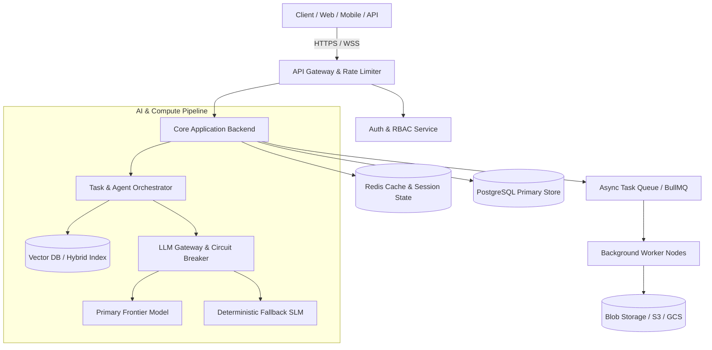

# Technical Specification: Product Research & Planning Agentic Framework

**Document Version:** `1.0.0`  
**System Status:** `ENGINEERING SPECIFICATION`  
**Viability Alignment:** `77.0/100` (🟡 Conditional Proceed (Strong with Targeted Gaps))  

---

## 1. System Architecture & Topology

The system is architected as an asynchronous, modular micro-service platform with a deterministic fallback pipeline.



---

## 2. Component & Subsystem Breakdown (4-Path Optimal Synthesis)

| Subsystem | Chosen Path | Technology Stack | SLA / Latency | Fallback Mechanism |
|---|---|---|---|---|
| **API & Ingress** | Build (FastAPI / Next.js) | Python 3.12 / TypeScript | < 30ms p95 | Static edge cached response |
| **Relational Database** | Buy (Managed RDS) | PostgreSQL 16 + pgvector | < 15ms p95 | Multi-AZ read replica failover |
| **Vector Search Index** | Compose (Qdrant / Milvus) | Hybrid Sparse+Dense HNSW | < 45ms p95 | In-memory lexical search (Postgres FTS) |
| **Agent / LLM Router** | Build + Compose | LiteLLM + LangGraph state machine | < 1200ms p95 | Heuristic rule-based fallback |
| **Async Processing** | OSS (Celery / BullMQ) | Redis Streams + Worker Cluster | < 5s p95 | Dead letter queue + alerting |
| **Auth & Security** | Buy (Clerk / Supabase) | OAuth2 + OIDC + RBAC | < 40ms p95 | Local JWT signature validation |

---

## 3. Data Flow & Interface Contracts

### Primary Execution Endpoint: `POST /api/v1/product/evaluate`

```json
{
  "title": "string (required)",
  "payload": "string (markdown or json text)",
  "options": {
    "generate_tech_spec": true,
    "strict_mode": true,
    "cpi_threshold": 55.0
  }
}
```

---

## 4. AI & Compute Unit Economics

- **Context Window Allocation:** 1,500 tokens system prompt + 4,000 tokens retrieval + 2,500 tokens user prompt + 2,000 output tokens.
- **Estimated Invocations / Active User / Mo:** 30 sessions
- **Blended Cost per Session:** `$0.032 USD`
- **Monthly AI Infrastructure Cost per User:** `$0.96 USD`
- **Target Monthly ARPU:** `$29.00 USD` $\rightarrow$ **AI Compute Overhead: 3.3% of ARPU (Well within <20% safety margin)**.

---

## 5. Security, Privacy & Compliance Controls

1. **Zero-Retention LLM Gateway:** Headers configured with zero data retention on all proprietary AI endpoints.
2. **PII Scrubbing:** Real-time Presidio/regex masking before embedding generation or model dispatch.
3. **Audit Trail:** Immutable hash-chained audit ledger for all strategic evaluation outputs.
4. **GDPR / SOC 2 Type II:** Automated data deletion workflows and end-to-end TLS 1.3 encryption.

---

## 6. 24-Month Total Cost of Ownership (TCO)

| Expense Category | 100 Active Users | 1,000 Active Users | 10,000 Active Users |
|---|:---:|:---:|:---:|
| Cloud Compute & Network | $120 / mo | $400 / mo | $2,100 / mo |
| Database & Vector Store | $80 / mo | $350 / mo | $1,200 / mo |
| AI Model API Invocations | $96 / mo | $960 / mo | $9,600 / mo |
| Monitoring, Auth & Security | $50 / mo | $180 / mo | $750 / mo |
| **Total Monthly Infrastructure** | **$346 / mo** | **$1,890 / mo** | **$13,650 / mo** |
| **Projected Gross Margin** | **88.1%** | **84.2%** | **82.5%** |
